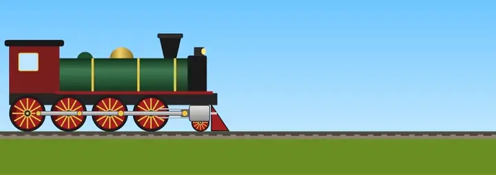
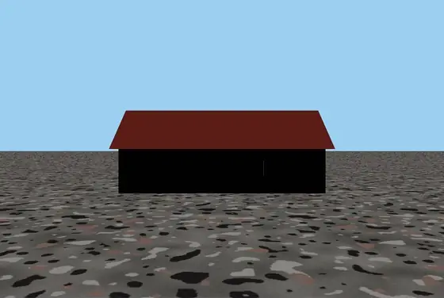
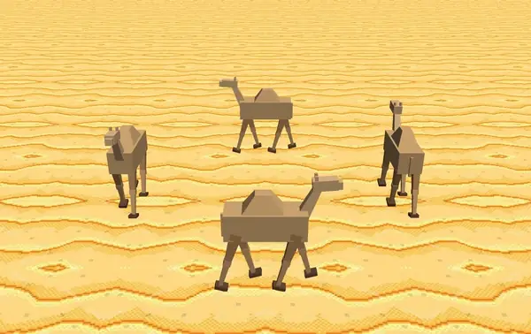

# Processamento de Imagens — Engenharia da Computação

Trabalhos práticos da disciplina, feitos em **WPF (C#, .NET 8)** com o Visual Studio 2022.

| Trabalho | Pasta | Conteúdo |
|---|---|---|
| **C1** | [`Unidade 1/TrabalhoC1`](Unidade%201/TrabalhoC1) | Locomotiva a vapor 2D: rodas girando, bielas sincronizadas (mecanismo biela-manivela) e deslocamento de ida e volta. |
| **C2** | [`Unidade 2/TrabalhoC2`](Unidade%202/TrabalhoC2) | Casa 3D: três cômodos e telhado montados com `MeshGeometry3D`, chão de granito texturizado, câmera orbitando e duas luzes direcionais girando. |
| **C3** | [`Unidade 3/TrabalhoC3`](Unidade%203/TrabalhoC3) | Modelagem hierárquica 3D: quatro camelos articulados (7 juntas animadas) caminhando em círculo sobre um deserto. |

## Animações finais

### C1 — Locomotiva a vapor 2D



[Vídeo da animação em MP4](https://github.com/RoberliSchuina/Processamento_de_Imagens_Engenharia_da_Computacao/releases/download/apresentacoes-finais/TrabalhoC1_Animacao.mp4) (25 s)

### C2 — Casa 3D



[Vídeo da animação em MP4](https://github.com/RoberliSchuina/Processamento_de_Imagens_Engenharia_da_Computacao/releases/download/apresentacoes-finais/TrabalhoC2_Animacao.mp4) (30 s)

### C3 — Camelos com modelagem hierárquica



[Vídeo da animação em MP4](https://github.com/RoberliSchuina/Processamento_de_Imagens_Engenharia_da_Computacao/releases/download/apresentacoes-finais/TrabalhoC3_Animacao.mp4) (32 s)

## Vídeos das apresentações

Apresentação final de cada trabalho: a explicação do código no Visual Studio 2022 e a animação em execução.
Os arquivos ficam na Release [Apresentações finais](https://github.com/RoberliSchuina/Processamento_de_Imagens_Engenharia_da_Computacao/releases/tag/apresentacoes-finais),
porque passam do limite de 100 MB por arquivo do repositório.

| Trabalho | Vídeo | Duração | Tamanho |
|---|---|---|---|
| **C1** | [TrabalhoC1_Apresentacao_Final.mp4](https://github.com/RoberliSchuina/Processamento_de_Imagens_Engenharia_da_Computacao/releases/download/apresentacoes-finais/TrabalhoC1_Apresentacao_Final.mp4) | 31:39 | 194 MB |
| **C2** | [TrabalhoC2_Apresentacao_Final.mp4](https://github.com/RoberliSchuina/Processamento_de_Imagens_Engenharia_da_Computacao/releases/download/apresentacoes-finais/TrabalhoC2_Apresentacao_Final.mp4) | 25:27 | 178 MB |
| **C3** | [TrabalhoC3_Apresentacao_Final.mp4](https://github.com/RoberliSchuina/Processamento_de_Imagens_Engenharia_da_Computacao/releases/download/apresentacoes-finais/TrabalhoC3_Apresentacao_Final.mp4) | 29:47 | 148 MB |

## Como executar

Requisitos: Windows e o .NET 8 (ou o Visual Studio 2022 com a carga de trabalho **Desenvolvimento para desktop com .NET**).

- **Visual Studio 2022:** abra o arquivo `.sln` do trabalho e pressione **F5**.
- **Linha de comando:**

  ```bash
  dotnet run --project "Unidade 1/TrabalhoC1/TrabalhoC1/TrabalhoC1.csproj"
  ```

  Troque o caminho pelo do C2 ou do C3 conforme o trabalho.
